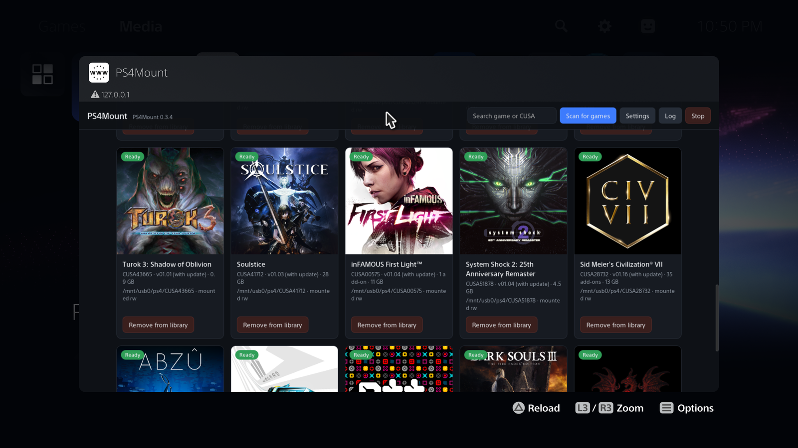
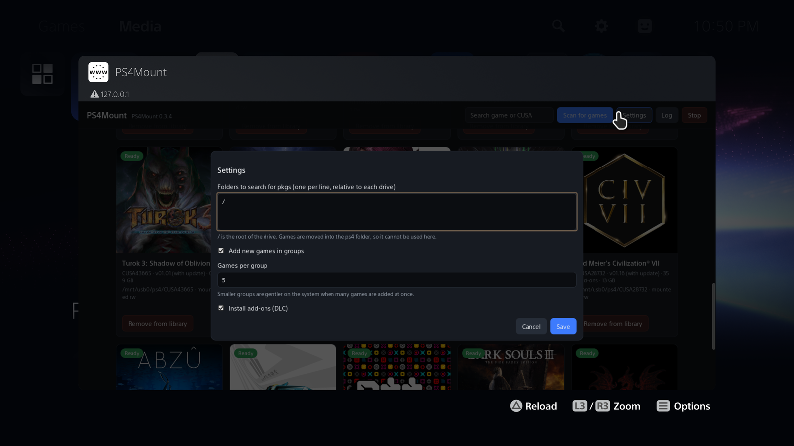

# PS4Mount v0.4.15 — DLC nativo ↔ USB (experimento reversível)

**Base:** v0.4.12 (sem `AppInstallAll` global e sem o isolamento de links da v0.4.14).

- **Registrar DLCs (USB):** conserva a revalidação experimental `AppInstallTitleDir`. Não se comprovou a criação de registros de DLC por essa API.
- **Instalar DLCs (NATIVO / SSD):** reintegra `InstallByPackage` por DLC, como na v0.4.10. **Copia dados para armazenamento interno**, ocupa espaço e cria operações reais de instalação. Usar com conhecimento desse efeito.
- **Testar 1 DLC no USB:** habilitado SOMENTE para RE7 `CUSA03842 / BH70000000DLC001`, previamente instalado nativamente no M.2. Confere os bytes do PKG nativo contra o PKG do USB, prepara metadados a partir da instalação nativa e tenta `nullfs` sobre **um diretório** em `/mnt/ext1/user/addcont/...`, expondo um link para USB. **Não apaga, renomeia ou substitui o `ac.pkg` nativo**; ele fica oculto sob a montagem durante o teste. Não libera espaço no SSD e não altera o banco.
- **Restaurar DLC no SSD:** desfaz apenas a montagem do teste se ainda pertencer ao PS4Mount, revelando a instalação nativa. Não usa `MNT_FORCE`.
- **Diagnosticar DB:** leitura filtrada e somente leitura de `addcont.db`, herdada da v0.4.12.

**O experimento não está comprovado no PS5.** Pode falhar ao montar em `/mnt/ext1`, o jogo pode consultar outro caminho/cache e a aceitação dos DLCs depende do sistema. Veja [TESTE-DLC-SSD-USB-0415.md](TESTE-DLC-SSD-USB-0415.md).

Nenhuma chamada a `sceAppInstUtilAppInstallAll(NULL)` existe nesta versão. Todas as ações de teste são manuais e individuais. Não inicie o jogo durante a alteração de montagem; apenas abra depois que o log indicar `ACTIVE` e feche antes de restaurar. Preserve backup antes de testes em armazenamento do console.

## Mudanças na 0.4.7 (bundle de DLCs)

- **Montar** trata jogo base, atualização disponível e todas as pastas externas de DLC como um conjunto. Em caso de falha, desmonta somente as novas camadas criadas pela tentativa atual.
- **Desmontar**, no painel, libera as camadas de DLC sob controle do PS4Mount, depois atualização e base, mantendo os registros dos jogos e arquivos do USB. Se outro jogo ainda estiver usando uma mesma camada de DLC, ela é preservada para esse outro jogo.
- Desmontagem encontra IDs dos DLCs pelas pastas e pelo cache de jogos ativos, **sem abrir ou ler todos os PKGs**.
- O limite de identificação de pastas distintas de DLC foi ampliado de 8 para 64.
- A preparação de DLCs apresenta andamento por DLC no próprio card.
- Na montagem, o log inclui `[manual][dlc-db]`: total de DLCs, IDs com registro localizado no banco `addcont.db`, IDs sem registro localizado e situações indeterminadas. Essa consulta é **somente leitura**, não modifica o banco do PS5.

**Limitação relevante:** preparar e montar `ac.pkg` **não significa** registrar os DLCs no serviço de entitlements do PS5. O código continua registrando o jogo base individualmente com `AppInstallTitleDir`. Não foi introduzida uma chamada de registro individual de DLC sem API/ABI validada, nem foi ativado `AppInstallAll`, que tinha histórico de falha grave. Uma linha `database_registered` confirma apenas a presença de um registro no banco, não prova que o DLC foi aceito pelo jogo. É necessário testar o reconhecimento dos DLCs no console.

**Testes locais:** os testes existentes, checagens de contrato da operação em grupo, sintaxe do backend com cabeçalhos PS5 simulados e uma consulta SQLite em banco de teste passaram. A compilação real com o SDK e o teste no console continuam pendentes.

---

> **Código-fonte PS4Mount 0.4.6, evoluído a partir da versão manual 0.4.5 (base 0.4.4).**
> Para o comparativo, mudanças e limitações, consulte [MELHORIAS-BASE-CORRETA.md](MELHORIAS-BASE-CORRETA.md). **Não é um ELF pronto para PS5.**

# PS4Mount 0.4.4 — montagem manual e progresso da busca USB (experimental)

> Fork de teste baseado na **0.4.1 do gasb07**, mantendo a busca recursiva da nossa
> versão anterior. **Não é uma versão oficial do autor.** O ELF não foi executado no
> PS5 neste ambiente. A compilação com o SDK real ocorre no GitHub Actions.

## Como usar

1. Compile no GitHub Actions (`git push` ou *Run workflow*); instale o payload como de costume.
2. Inicie o ELF e abra **`http://IP_DO_PS5:8770`**. Não ocorre busca ou registro automático
   de jogos novos. O atalho existente na aba Mídia pode continuar funcionando; o ELF
   **não o reinstala automaticamente** para não chamar `AppInstallAll`.
3. O ELF tenta **restaurar apenas montagens de jogos anteriormente registrados/ativos**
   (marcador `.src` válido e não `.disabled`). O painel mostra barra de progresso;
   há notificação no começo e no fim, se houver jogos a restaurar.
4. Clique em **Buscar jogos no USB** para procurar PKGs em pastas e subpastas.
   Enquanto a busca acontece, o painel mostra pastas percorridas, PKGs examinados,
   arquivos organizados e a pasta atual, com barra animada (total ainda desconhecido).
   **ATENÇÃO: esta descoberta organiza/move os PKGs no mesmo HD externo**, seguindo
   o comportamento original: `ps4/<CUSA>/app.pkg`, `patch.pkg` e add-ons.
   Buscar não registra nem monta jogos novos.
5. Clique em **Montar** no cartão do jogo selecionado. Jogos já registrados
   serão remontados mesmo se seus antigos marcadores estiverem ausentes ou
   desatualizados; nesse caso, os arquivos auxiliares podem ser reconstruídos a
   partir dos PKGs presentes no USB. Se ainda não estiver registrado, tenta o
   registro individual `AppInstallTitleDir` **quando disponível**. Não há fallback global.
6. **Desmontar** libera as montagens de app/patch identificadas como nossas,
   interrompe sua recuperação nas próximas inicializações e **não desinstala** o
   registro do PS5. As montagens de DLC compartilhadas não são forçadas a sair.
   **Encerrar ELF** encerra o daemon (na recuperação, após concluir o título atual).

## DLCs: limite importante

Ao montar um título, o fluxo original pode preparar os arquivos auxiliares para sua
atualização e DLCs encontradas. Quando existem várias DLCs, seu **preparo** ocorre
em grupos configuráveis (padrão de 5), com cada grupo registrado no log. **Isso
não garante que os registros das DLCs sejam efetivamente concluídos no banco do
PS5 pela API individual do jogo.** Os PKGs continuam no HD externo. Não confunda
"DLC preparada" com "DLC instalada"; precisamos confirmar esse comportamento
com um teste real no PS5. O sistema possui limites de dispositivos de montagem.

## Segurança e persistência

- `/data/ps4mount/CUSAxxxxx.src`: marcador da origem do PKG. Na montagem manual
  de um título já registrado, ele pode ser atualizado a partir do PKG escolhido,
  sem exigir um marcador antigo válido. A recuperação automática ainda exige
  uma fonte persistida e validação antes de montar.
- `.active`: jogo incluído na recuperação automática; `.disabled`: exclusão
  explícita dessa recuperação, sem desinstalar; `.attempt`: tentativa de registro
  em andamento/interrompida. **Não apague `.attempt` sem analisar o log e o estado
  do PS5**, pois isso pode permitir repetir uma operação parcialmente executada.
- Recuperação nunca roda busca recursiva, reorganização ou registro automático;
  falhas individuais ficam no log. Montagens desconhecidas não são desmontadas à
  força. O banco `app.db` é somente consultado pela aplicação (o sistema faz o
  registro). Jogar continua dependendo do ambiente de homebrew carregado.
- **Use backup restaurável**. O projeto modifica metadados internos ao registrar
  jogos. Não foi validado no console nesta compilação, especialmente com 150 jogos
  e muitas DLCs. Comece com um jogo e avalie o log antes de ampliar.

## Testes

Execute `bash test/run.sh` em Linux com `xxd`, compilador C e Python 3 instalados.
O script inclui os 125 testes originais, o teste recursivo e verificações estáticas
adicionais do contrato manual. Sintaxe C/JavaScript também foi verificada no host.
**Esses testes não substituem a compilação com SDK PS5 nem testes no console.**

---

## Documentação original do PS4Mount

# PS4Mount

Play PS4 fake PKGs on a jailbroken PS5 straight from a USB drive, without installing them.

Put the game (and its update) `.pkg` files on a USB drive, plug it in and load `ps4mount.elf`.
PS4Mount finds the packages, adds the games to the home screen and lets you play them from the
drive. Nothing is copied to the console storage, and deleting a game on the console only removes
it from the library: the `.pkg` stays on the drive.


## Screenshots

Notifications on the home screen while PS4Mount scans the USB drives:


The web panel, opened from the **Media** tab:



## Features

- Detects PS4 fake PKGs (game, update and add-ons) in the root **and subfolders** of any connected USB drive, or in other
  folders chosen in the settings. The scan includes nested folders automatically (up to 16 levels).
- Adds the games to the home screen with their icon, name and update version.
- Applies updates: put the update `.pkg` next to the game and it is picked up automatically.
- Installs add-ons (DLC), with data or unlock-only. An add-on is matched to its game by title ID, or by
  the add-on IDs the game lists (so add-ons of another region of the same game work too).
- Adds many games in groups, so a drive with dozens of games does not overload the console.
- Games run from the drive; no internal storage is used for the packages.
- Deleting a game from the PS5 removes it from the library only. The `.pkg` is never deleted.
- Notifications while scanning (how many games were found on each drive) and for added and removed
  games.
- A web panel, also available as **PS4Mount** in the **Media** tab, to see the games and add or
  remove them from the library.

## Requirements

- A jailbroken PS5 with fake PKG support (for example etaHEN with kstuff).
  Tested on firmware **13.20**. Other firmware versions are untested.
- An ELF loader listening on port **9021** to send the payload.
- Access to the kernel log: either **klogsrv** running on port 3232, or no other payload reading
  `/dev/klog`. PS4Mount reads the system log to know when a game starts and when a delete is
  confirmed. Without it, games cannot start (see [How it works](#how-it-works)).
- A USB drive formatted as **exFAT**.
- PS4 **fake** PKGs (game, and optionally its update and add-ons). Retail PKGs are not supported.

## Usage

Download `ps4mount.elf` from the [Releases](https://github.com/gasb07/ps4mount/releases) page
(or [build it](#building)).

1. Copy the PS4 game `.pkg` (and its update and add-on `.pkg` files, if you have them) to the **root or any subfolder**
   of the USB drive. The file names do not matter.
2. Plug the drive into the PS5.
3. Send `ps4mount.elf` to the ELF loader (port 9021). Do this after every console boot, or add it to
   the payloads your jailbreak loads automatically.
4. Wait for the notifications:
   - `Scanning usb0 for PS4 games...`
   - `usb0: 2 PS4 game(s) found, 2 new or updated`
   - `Adding 1/2: <game name> (CUSAxxxxx)`
   - `<game name> ready to play`
5. Start the game from the home screen.

On the first run PS4Mount moves every package it uses into a folder per game on the same drive:

```
/ps4/CUSAxxxxx/app.pkg                          game
/ps4/CUSAxxxxx/patch.pkg                        update (optional)
/ps4/CUSAxxxxx/addcont/CUSAyyyyy/<LABEL>/ac.pkg add-on (optional)
```

A game is reported as ready only after its add-ons are installed too. An add-on whose game is not on the
same drive stays where it is and waits: it is moved and installed as soon as its game is on the drive.
The scan notification says how many add-ons are waiting.

Keep this layout. To add more games later, copy their `.pkg` files anywhere in the drive folders. PS4Mount finds them recursively and moves them to its managed `ps4/<TITLE_ID>/` layout.

### Web panel

Open **PS4Mount** in the **Media** tab, or browse to `http://<PS5 IP>:8770` from any device on
the same network. The panel shows every game found on the connected drives, with its state:

| State | Meaning |
| --- | --- |
| Ready | In the library and ready to play |
| Running | The game is open |
| Not in library | Removed from the library; the `.pkg` is still on the drive |
| Adding | Being added to the library |
| Installed on console | A normal installation of this game exists; PS4Mount leaves it alone |
| On another drive | The same game is also on another connected drive, which is the one used |

Buttons:

- **Remove from library**: removes the game from the home screen. The `.pkg` stays on the drive.
- **Add to library**: adds a removed game back.
- **Scan for games**: checks the drives now and shows how many games were found on each one.
- **Settings**: see below.
- **Log**: shows the PS4Mount log.
- **Stop**: stops PS4Mount. Its games cannot start until it is loaded again.

### Settings



| Setting | Default | Meaning |
| --- | --- | --- |
| Folders to search for pkgs | `/` | Folders, relative to each drive, searched **recursively** for new `.pkg` files (one per line). `/` searches the entire drive. Existing `ps4/CUSAxxxxx/` game folders are skipped by package discovery because the original loader handles them separately. |
| Add new games in groups | On | Adds many new games in groups instead of one after the other, which keeps the console stable when a drive has a lot of games. |
| Games per group | 5 | Size of each group (1 to 50). |
| Install add-ons (DLC) | On | Moves and installs add-on `.pkg` files. When off, add-ons are left where they are. |

Settings are saved in `/data/ps4mount/config.txt`.

The panel has no password. Anyone on your local network can open it.

### Removing games

Deleting a game from the PS5 (Options > Delete on the home screen, or Settings > Storage), or using
**Remove from library** in the panel, removes the game from the library and leaves the `.pkg` on the
drive. A removed game comes back
when you reconnect the drive or click **Add to library**.

To delete the game for good, delete its `/ps4/CUSAxxxxx` folder from the drive on a computer.

## Good to know

- Load PS4Mount soon after every boot. While it is not running, the console does not see the
  packages and may hide the games; they come back as soon as PS4Mount runs again.
- Do not unplug the drive while a game is running.
- **Two or more drives connected at the same time can make the whole console interface slow** (home
  screen, Control Center, game hubs), with or without PS4Mount: the system checks its storage devices
  more often with each extra drive or partition. A drive with extra partitions (for example a boot
  partition added by a multiboot tool) counts as several. If the interface gets slow, keep one drive
  connected, ideally with a single partition.
- For a game with an update, the library and the PS5's own "installed" notification show the version
  of the game pkg (for example 01.00). The game runs with the update; the web panel shows its version.
- Games already installed the normal way on the console are never touched, and their add-ons on the
  drive are not installed.
- Rest mode powers the drive off. The games stay in the library and work again after waking up.
- **Games with more than about 29 add-ons:** while a game runs, the console mounts each of its packages (the game,
  the update and every add-on) with two virtual devices: a PS4 package holds an outer filesystem with the
  real content as a second filesystem inside it. The console has 64 of these devices, so a running game
  can use at most about 30 packages: the game, its update and roughly 29 add-ons. A game with more
  add-ons (for example Civilization VII with 35) starts normally but only sees the first add-ons, in
  alphabetical order of their label. This is a console limit that applies to installed games too; it
  does not limit how many games you can have.
- If a game fails to start right after being added, start it again. The log (panel > **Log**) shows
  what happened.

## Reporting problems

If something does not work, open an issue at
[github.com/gasb07/ps4mount/issues](https://github.com/gasb07/ps4mount/issues) with:

1. **PS4Mount version**: shown at the top of the web panel and in the startup notification.
2. **PS5 firmware** and the **jailbreak / HEN** you use, with its version (for example etaHEN 2.x
   with kstuff).
3. **The game**: name and title ID (`CUSAxxxxx`), and whether it has an update (the version shown
   in the panel).
4. **What happened**: what you did, what you expected, and the exact message or error code shown on
   the console.
5. **The log**: open the web panel, click **Log** and copy the text, or download
   `/data/ps4mount/log.txt` over FTP. Include the part from the moment the problem happened.
6. **Your setup**: whether klogsrv is running, how the drive is formatted (exFAT) and other payloads
   you load at the same time.

Do not attach `.pkg` files or links to them.

## How it works

A PS4 PKG install on the PS5 is mostly a byte copy of the package to `/user/app/<TITLE_ID>/app.pkg`
plus some metadata. PS4Mount skips the copy:

1. It writes the files an install would leave on the console, generated from the package itself:
   `app.json`, `app.pbm`, `app.xml`, `patch.*`, the PlayGo records (`/user/playgo/...`,
   `/system_data/playgo/<TITLE_ID>/pfs.pbm`), the app metadata, and the fake license (`.rif`/`.idx`)
   decrypted from the package.
2. The game files go into an internal folder, `/system_data/ps4mount/app/<TITLE_ID>` (and
   `/system_data/ps4mount/patch/<TITLE_ID>` for an update), where `app.pkg` and `patch.pkg` are
   symbolic links to the packages on the drive. That folder is mounted over `/user/app/<TITLE_ID>`
   (and `/user/patch/<TITLE_ID>`) with `nullfs`. The drive itself is never mounted there.
3. It asks the system to register the title (`sceAppInstUtilAppInstallAll`), which adds it to the
   library and refreshes the home screen. PS4Mount never writes to the system databases itself.
4. A delete from the console can only remove the links, never the packages. While a delete screen
   is open (on the home screen or in Settings > Storage) PS4Mount also unmounts the game folders,
   so the system can remove `/user/app/<TITLE_ID>` without an error.

State and log are kept in `/data/ps4mount/`. The Media tab shortcut is `PMNT00001`
(`/user/app/PMNT00001`).

## Building

Requirements: the [PS5 Payload SDK](https://github.com/ps5-payload-dev/sdk) in `/opt/ps5-payload-sdk`
(or set `PS5_PAYLOAD_SDK`), `xxd` and bash.

```sh
./build.sh          # builds build/ps4mount.elf
```

Unit tests (crypto, the generated install files and the `param.sfo` parser) run on the computer, with
no console or SDK:

```sh
bash test/run.sh
```

GitHub Actions runs them before every build.

Optional tools:

```sh
python3 tools/make_icon.py                                 # redraws assets/icon0.png (needs Pillow)
python3 tools/gen_keys.py <LibOrbisPkg>/LibOrbisPkg/Util/Keys.cs   # regenerates src/keys.h
```

### Releases

GitHub Actions (`.github/workflows/build.yml`) builds every push and pull request with the PS5
Payload SDK release set in `SDK_VERSION`, and keeps `ps4mount.elf` as a build artifact.

To publish a release:

1. Set the new version in `src/main.c` (`#define VERSION "PS4Mount X.Y.Z"`) and commit it.
2. Tag the commit and push the tag:
   ```sh
   git tag vX.Y.Z
   git push origin vX.Y.Z
   ```

The workflow checks that the tag matches `VERSION`, builds the payload and creates the GitHub
release with `ps4mount.elf` and its SHA-256 checksum attached.

| Path | Content |
| --- | --- |
| `src/main.c` | Daemon: drive scan, registration, mounts, klog events, panel actions |
| `src/pkg.c` | PKG reader and fake-key entry decryption |
| `src/build.c` | Generators for the install files (app/patch metadata, PlayGo records, license) |
| `src/db.c` | Library rows (`app.db`, `appinfo.db`) |
| `src/crypto.c` | SHA-256, AES-128-CBC, CRC32C, RSA-2048 |
| `src/web.c`, `web/index.html` | Web panel |
| `test/` | Unit tests (`bash test/run.sh`) |
| `tools/pdb_*_template.bin` | PlayGo record layouts (no title data) |
| `third_party/sqlite/` | SQLite amalgamation |

## Credits

PS4Mount does not contain code copied from other projects except where noted below.

| Project | Author | License | Use |
| --- | --- | --- | --- |
| [PS5 Payload SDK](https://github.com/ps5-payload-dev/sdk) | John Törnblom | GPL-3.0-or-later | Toolchain, headers and runtime linked into the payload |
| [LibOrbisPkg](https://github.com/maxton/LibOrbisPkg) | maxton | LGPL-3.0 | Source of the fake PKG key (`PkgDerivedKey3Keyset`, in `src/keys.h`) and reference for the PKG entry encryption, entry IDs and the `playgo-chunk.dat` layout |
| [SQLite](https://sqlite.org) | SQLite authors | Public domain | `third_party/sqlite/` (amalgamation 3.46.1), used to write the library databases |
| [ShadowMountPlus](https://github.com/drakmor/ShadowMountPlus) | drakmor | GPL-3.0 | Inspiration for auto-mounting games from USB drives and for registering titles with `sceAppInstUtilAppInstallAll` on firmware 12.00+. No code was used. |
| [ps5-app-dumper](https://github.com/EchoStretch/ps5-app-dumper) | EchoStretch | see project | Reference for the Media tab shortcut (`applicationCategoryType` 65536 with `deeplinkUri`). No code was used. |

## License

PS4Mount is licensed under the GNU General Public License v3.0 or later, see [LICENSE](LICENSE).
It links the PS5 Payload SDK runtime (GPL-3.0-or-later). `src/keys.h` carries data published by
LibOrbisPkg under the LGPL-3.0. SQLite is in the public domain.

This project is not affiliated with or endorsed by Sony Interactive Entertainment. Only use it with
games you own.

### Folder scan adaptation (custom fork)

This fork is based on upstream **PS4Mount 0.4.1**. Its only functional change is
recursive `.pkg` discovery: for example `Games/Title/app.pkg`,
`Games/Title/Updates/patch.pkg`, and `Games/Title/DLCs/*.pkg` can be
found without being in the USB root. As in upstream, recognized packages
**are moved on the same USB drive** to `ps4/<TITLE_ID>/` (or the matching add-on
folder); this is not a read-only scan. It does not copy game PKGs to PS5 internal
storage. Group registration, DLC install, automatic scans and web UI remain
upstream behavior. Directory symlinks and other filesystem devices are not
followed, and managed title folders are skipped during discovery.
